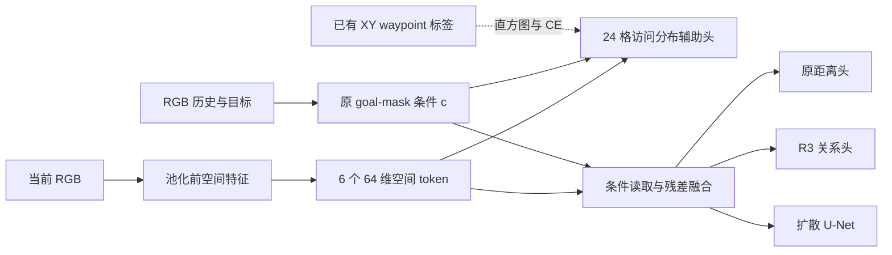

# R1：轨迹引导的空间瓶颈——修改计划与实现记录

2026-11-08：用户确认改用 **RGB 和现有轨迹的访问分布监督**，不增加几何真值。本文替代此前深度/占据标签实现计划。代码已接入，**本轮未运行测试、语法编译、训练或仿真**，Ubuntu 运行结果尚待验证。

首次交付见 [R1 修改报告](R1_CHANGE_REPORT.md)。后续审查修复、完整机制对照、统计/恢复兼容性与运行比较入口见 [R1 审查修复报告](R1_REVIEW_FIX_REPORT.md)，以该报告为最新变更记录。

## 1. 最终范围

- 保留 6 个 64 维空间 token，输出 6×4 个区域的未来 waypoint 访问分布，不再预测 free/occupied/unknown。
- 当前 RGB 池化前的空间特征生成 token，目标不进入 token 提取；原 goal-mask 条件参与 token 读取及访问分布预测。
- 残差融合后仍是 256 维条件，供原 temporal-distance 头、R3 头和扩散 U-Net 共用。
- R1 标签只由现有动作 batch 的 XY waypoint 生成，不增加深度、碰撞、占据、NavMesh、可见性或预训练教师。
- 沿用 Habitat 随机初始化、全参数训练、RGB 预处理和动作尺度。R3 保留既有关系监督；组合实验不能声称 R3 也不使用几何监督。

访问分布表达**示范轨迹在预测时域内经过哪里**。没有经过某格不代表该格不可通行，低概率也不是碰撞风险。辅助分布丢弃时间顺序，完整有序轨迹仍由扩散损失学习。

## 2. 文件修改清单

路径相对 `visualnav/train/`；下列接线均未执行运行验证。

| 步骤 | 文件 | 改动 |
|---|---|---|
| 1 | `vint_train/models/nomad/spatial_bottleneck.py` | 空间 token、条件访问分布头、零初始化残差；替代原 geometry_bottleneck 草稿 |
| 2 | `vint_train/models/nomad/nomad_vint.py`、`nomad.py`、`models/factory.py` | 读取当前帧空间特征；默认仍返回条件张量，`return_r1=True` 额外返回 token/logits；工厂记录架构及分段定义 |
| 3 | `vint_train/data/trajectory_regions.py`、`prepare_r1_data.py` | 仅从训练轨迹拟合距离分段，校验尺度、采样和数据签名；不新增标签数据流 |
| 4 | `vint_train/training/trajectory_visitation.py`、`goal_relation_train.py` | waypoint 转软直方图、有效样本 CE、累积窗口归一化 |
| 5 | `vint_train/training/simulation_train.py` | spatial 参数组、三种 mask 验证、辅助梯度诊断、统计/配置记录；沿用 AMP、EMA 与严格恢复 |
| 6 | `train.py`、`config/nomad_r1_r3_habitat.yaml` | R1 独立开关、四组主实验及机制消融；原 R3 命令仍可使用 |
| 7 | `vint_train/inference/rgb_policy.py` | 可选访问分布诊断；正常 RGB 导航自动使用融合条件，不运行辅助头 |

R1 关闭时不新增模型参数或 model_config 字段。公共模块先初始化；R1 在独立 CPU RNG 上下文中创建，再恢复 RNG 创建 R3。启动时额外构建同种子 CPU baseline，强制核对共同初始权重。`initial_common_weights_sha256` 排除 R1/R3 附加模块；新增模块另存初始哈希。

## 3. 模型与监督定义

当前帧特征 `F[B,C,Hf,Wf]` 经 1×1 投影、归一化图像坐标的位置编码、6 个 learned queries 的交叉注意力和 FFN，得到 `Z[B,6,64]`。这些特征不能直接称为米制占据图。

原 NoMaD 条件为 c。辅助头读取 `(Z_j,c)`，每个 token 输出 4 个径向 logits，**所有 24 格统一 softmax**。完整模式另以 c 查询 Z，将结果经零初始化输出层残差加入 c。辅助头使用融合前的 c，让有/无反馈对照保持同一辅助任务接口。



### 标签规则

1. `batch[2]` 已是累计局部 waypoint，乘 `action_scale_m` 恢复米制位置；不再次累加，也不把 diffusion 的归一化 delta 当坐标。
2. 方位从 +x 前方向 +y 左方增加。默认 6 个均匀扇区覆盖整圈，扇区 0 为 [-30°,30°)，然后逆时针排列。这是轨迹坐标分区，不是相机可见区域。
3. 四个距离段的三个内部边界采用训练 waypoint 半径的 25%、50%、75% 分位数。最后一段无有限上界；恰落边界的点进入右侧区间。重复边界会报错，不悄悄改变 bin 数，应检查数据或明确修改配置后重拟合。
4. 半径不超过 `stationary_epsilon_m=1e-4` 的点不计数，解决原点方位未定义的问题。它不是机器人尺寸或安全距离。
5. 其余 waypoint 等权计数，非原点的重复停留点保留时间权重。每条样本直方图归一化为 1。
6. 只监督原 `action_mask>0` 的样本；负目标、原动作距离范围外或全静止样本不贡献辅助损失。goal mask 不改变资格。R3 额外关系样本不增加 R1 监督量。

原数据集的动作标签始终是未来 `len_traj_pred` 个 waypoint，不按随机目标帧截短；本实现沿用该语义。未来 waypoint 只进入 target 构造，不进入前向输入。

距离分段拟合对每个有可能获得有效动作监督的训练观测计一次，不受目标重复采样影响。默认固定 `fit_seed=0`，以最多 200000 点的均匀优先级 reservoir 限制内存后取分位数，小数据使用全部点。记录总候选点数、静止点数、采样点数和协议。只有 train 参与拟合；manifest 加载器仍检查其他划分的既有完整性。

累计窗口 W 的辅助损失为：

`L_visit = sum_{i in valid(W)}[-sum_b q_i,b * log p_i,b] / count(valid(W))`

原 NoMaD/R3 总目标增加 `lambda_visitation * L_visit`。默认 0.1 是待验证初值。按整个窗口有效样本数归一化，不能先求各 microbatch 均值再平均；全无效时不产生该项梯度。

## 4. Ubuntu 命令

以下从 `visualnav/train` 执行。先改新 YAML 中 manifest、action_statistics、r1_statistics 三个路径。已有动作统计若与数据/尺度一致可以复用，否则先运行原工具：

```bash
python -m vint_train.data.prepare_sim_data \
  --manifest /data/habitat/manifest.json \
  --output /data/habitat/action_stats.json --context-size 3 --horizon 8

python -m vint_train.data.prepare_r1_data \
  --config config/nomad_r1_r3_habitat.yaml
```

第二条拟合分段与常量访问先验，不采集数据或训练网络。当前统计格式为 schema 2，旧 schema 1 需要重新生成。训练前固定统计，各训练种子共享它。改动轨迹、数据版本、尺度、context/horizon、采样间隔、动作资格范围或拟合设置后，需要重拟合并开始相应的新实验。

四组主实验分别运行：

```bash
python train.py -c config/nomad_r1_r3_habitat.yaml --ablation baseline --r1-mode off
python train.py -c config/nomad_r1_r3_habitat.yaml --ablation baseline --r1-mode bottleneck
python train.py -c config/nomad_r1_r3_habitat.yaml --ablation r_d --r1-mode off
python train.py -c config/nomad_r1_r3_habitat.yaml --ablation r_d --r1-mode bottleneck
```

`--ablation` 只控制 R3，`--r1-mode` 独立控制 R1；不能仅凭 `--ablation baseline` 判断 R1 关闭。新 YAML 默认启用 R1+R3，旧 R3 YAML 默认行为保留。

| R1 模式 | 空间反馈 | 访问分布监督 | 用途 |
|---|---|---|---|
| off | 无 | 无 | baseline / R3 |
| tokens_only | 有 | 无，权重 0 | 仅增加空间 token |
| auxiliary | 无 | 有 | 同一 token/辅助头、不反馈到策略 |
| bottleneck | 有 | 有 | 完整 R1 |
| global_auxiliary | 无 | 有 | 原 256 维条件直接接访问预测 MLP |
| pooled_auxiliary | 无 | 有 | 固定空间池化，替代查询 Token 提取 |
| pooled_bottleneck | 有 | 有 | 固定空间池化，保留同一反馈读取器 |

```bash
python train.py -c config/nomad_r1_r3_habitat.yaml --ablation baseline --r1-mode tokens_only
python train.py -c config/nomad_r1_r3_habitat.yaml --ablation baseline --r1-mode auxiliary
```

auxiliary 仍使用空间 token，访问 CE 仍会经共享编码器影响策略；“无反馈”仅指不向条件添加 Token 残差。与 global_auxiliary / pooled_auxiliary 比较时均保持无反馈，与 pooled_bottleneck 比较完整 R1 时均保持有反馈。未受任务梯度更新的 R1 参数记录在 provenance。tokens_only 的访问头没有训练，相关指标为 null，诊断接口拒绝将其当成受监督预测。

恢复使用同一 YAML、相同两个开关和 `--resume /path/to/checkpoint_latest.pth`，只接受匹配的完整 v2 checkpoint。模式、损失权重、分段定义、统计内容指纹、优化器参数顺序、随机协议和数据签名纳入恢复检查。新随机协议为 `epoch_streams_and_per_microbatch_branch_rng_v2`，旧协议断点不能声称严格续训到新协议。已有 R3 checkpoint 不能充当新增 R1 的断点；用户已再次确认从零训练。

## 5. 指标与推理

`steps.jsonl` 增加 visitation 分母、CE 和权重；`metrics.jsonl` 的训练及 random/goal/goal_free 验证增加 visitation：有效样本/waypoint 数、CE、目标熵、KL、L1、落在示范已访问格的概率质量、最高概率格是否被访问、各格平均目标/预测质量。它们不能替代闭环 SR、SPL、碰撞评价。

最新版本另记录训练集常量先验指标、固定 c 的跨样本 Token 置换诊断、分支梯度及实际更新预算。梯度探测覆盖观测 CNN、空间投影/查询、残差输出和原全局路径，区分没有连接与零梯度。运行公平性可用 `python -m vint_train.training.compare_ablation_runs` 核对，详见审查修复报告。

训练汇总来自优化过程中的前向，包含 AMP 跳过的窗口；验证使用 EMA。指标单独记录非有限预测数，仅对有限预测计算均值并报告 scored_samples 分母；loss 不过滤非有限预测，仍交由原 AMP/梯度检查处理。辅助头未训练或无有效评分样本时输出 null。几何 IoU、unknown→free 已不适用于新 R1。

正常导航仍调用 `score_rgb_pairs` / `sample_conditioned_actions`。访问头不参与轨迹重排序或停车逻辑，R3 选择器不变。部署使用对应运行的 `resolved_config.yaml`，保留 R1 分段定义。

```python
from vint_train.inference.rgb_policy import predict_rgb_visitation
model.eval()
result = predict_rgb_visitation(model, obs_images, goal_images)
# condition [B,256], spatial_tokens [B,6,64],
# visitation_logits / visitation_probability [B,6,4]
free_mode_result = predict_rgb_visitation(model, obs_images)  # goal mask = 1
```

helper 接收未 ImageNet 归一化的 RGB tensor。`model("spatial_tokens", obs_img=normalized_history)` 可单独返回目标无关 token。global_auxiliary 没有 Token，其诊断返回 `spatial_tokens=None`，独立 Token 提取会报错。画图应使用“访问分布与示范 waypoint”，不能沿用 free/occupied/unknown 图例。R1+R3 需要绑定自身权重和模型配置的新 schema 2 校准文件。

## 6. 待在 Ubuntu 验证

本轮仅阅读代码与审阅 diff，不把接线完成视为通过验收：

已附 `train/tests/test_r1_core.py` 和 `test_r1_protocol.py`，覆盖坐标链路/扩散往返、尺度与边界、无效样本、累积梯度、辅助路径、训练先验、当前帧与 goal mask、随机数隔离、初始化、校准和预算比较；**未执行**。Ubuntu 环境中可运行：

```bash
python -m unittest discover -s tests -p 'test_r1_*.py' -v
```

轻量单测之外仍需验证：

- 米制缩放、极坐标边界、负目标、全静止样本、24 格统一归一化。
- 累积窗口/尾窗与大 batch 的辅助梯度一致，无效样本不污染 loss。
- 当前帧索引、goal mask、目标无关 token、零初始化残差及梯度。
- AMP、activation checkpoint、EMA、完整恢复、改动统计后的拒绝恢复。
- 四组公共初始化和动作预算、机制对照、RGB 闭环效果、实际显存/耗时。

可学习视觉 token 已有先例，如 [TokenLearner](https://arxiv.org/abs/2106.11297)。该实现是待实证的研究候选，不保证显著收益或足够的论文创新。
